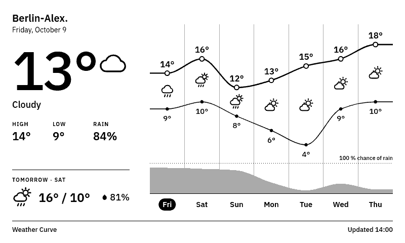
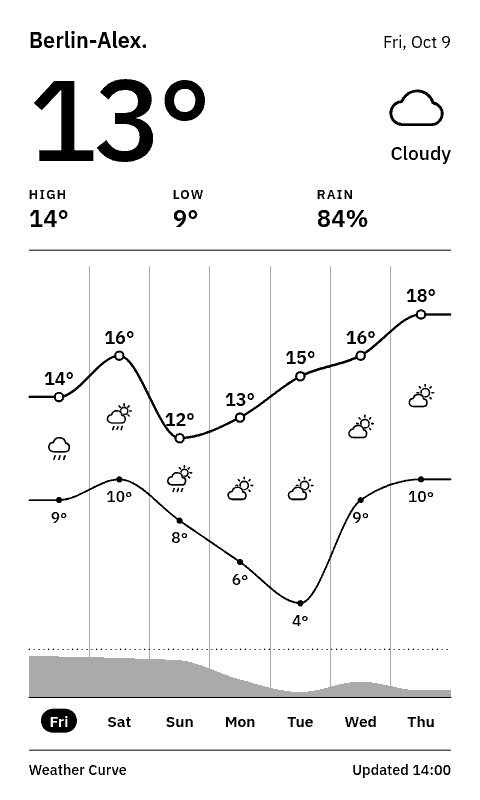
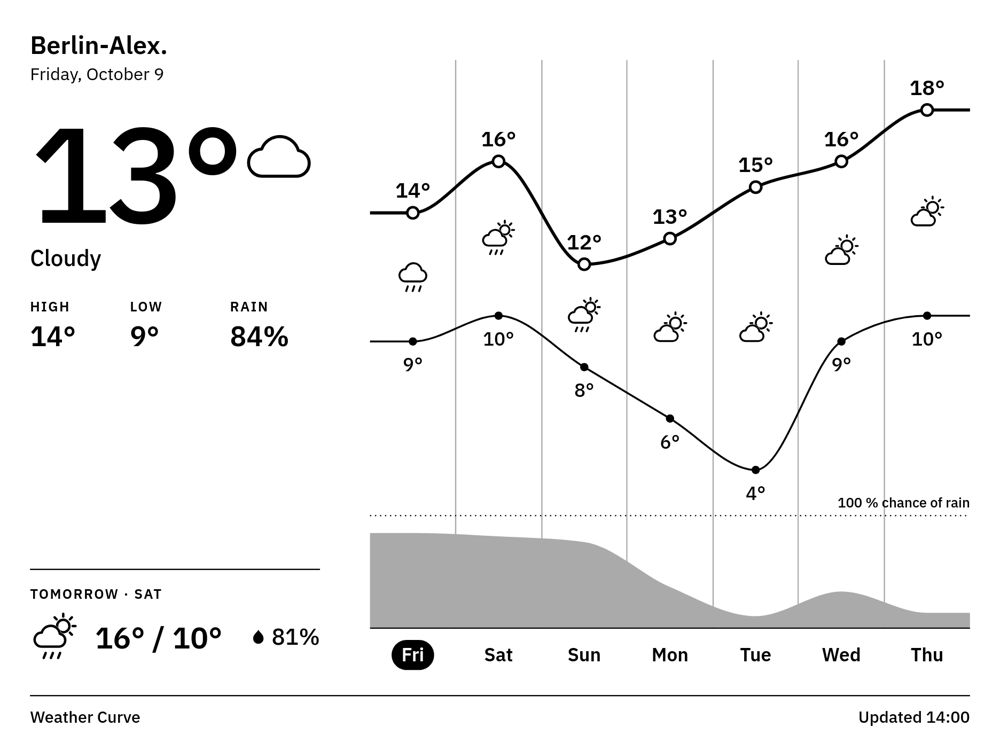
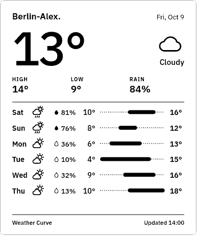
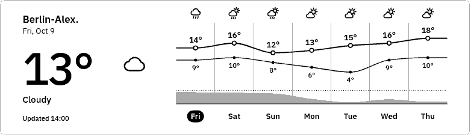
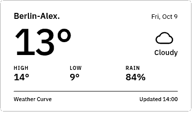

# Weather Curve (DWD)

A 7-day weather forecast for [TRMNL](https://trmnl.com) e-paper displays: one temperature curve for daily highs and lows, a weather icon per day, and the chance of rain as an area along the bottom.

**[Install on TRMNL](https://trmnl.com/recipes/weather-curve-dwd-500572)**



| Portrait | TRMNL X | Half (vertical) |
|---|---|---|
|  |  |  |

| Half (horizontal) | Quadrant |
|---|---|
|  |  |

## Features

- 7-day temperature curve with daily highs and lows, weather icons and chance of rain
- Current temperature, today's high/low/rain and an outlook for tomorrow
- German or English labels (or follow the TRMNL account language)
- Celsius or Fahrenheit (Fahrenheit also switches to a 12-hour clock)
- Flat gray on grayscale screens, a dot pattern on black-and-white screens
- All four TRMNL layouts (full, half horizontal, half vertical, quadrant), adapting to portrait and to TRMNL X

## Data

Two sources, picked per location (setting "Data source": Auto, DWD or Open-Meteo):

- **Europe (Auto):** [Deutscher Wetterdienst (DWD)](https://www.dwd.de) MOSMIX model, served by the free [Bright Sky](https://brightsky.dev) API. Auto uses it between 34° and 72° N, 11° W and 26° E. The DWD has no rain forecast for most stations outside Europe (and a few inside, e.g. Moscow or Minsk), so a day without rain data shows no rain instead of 0 %.
- **Everywhere else (Auto):** [Open-Meteo](https://open-meteo.com), free for non-commercial use, no API key.

No account or API key is needed for either.

Data: Deutscher Wetterdienst, [CC BY 4.0](https://creativecommons.org/licenses/by/4.0/), via Bright Sky. [Weather data by Open-Meteo.com](https://open-meteo.com/), [CC BY 4.0](https://creativecommons.org/licenses/by/4.0/). This project is not affiliated with or endorsed by the DWD or Open-Meteo.

## How it works

1. TRMNL polls Bright Sky or Open-Meteo hourly for the next 8 days of hourly data at the chosen location; a Liquid condition in the polling URL picks the source ([`src/settings.yml`](src/settings.yml)).
2. A serverless transform turns either response into the same 7 daily rows (about 190 hourly rows each) ([`src/transform.py`](src/transform.py)).
3. The views draw everything as one SVG per layout, in TRMNL's own Inter font ([`src/shared.liquid`](src/shared.liquid)).

## Development

Uses [trmnlp](https://github.com/usetrmnl/trmnlp) through Docker, no Ruby needed:

```sh
bin/trmnlp serve   # live preview at http://localhost:4567
bin/trmnlp lint
bin/trmnlp test
```

The preview uses Berlin. With the `trmnl_preview` gem installed, `TRMNL_LAT_LON="lat,lon"` overrides it without touching tracked files.

`bin/trmnlp login` and `bin/trmnlp push` upload the plugin to your TRMNL account.

## License

[MIT](LICENSE)
